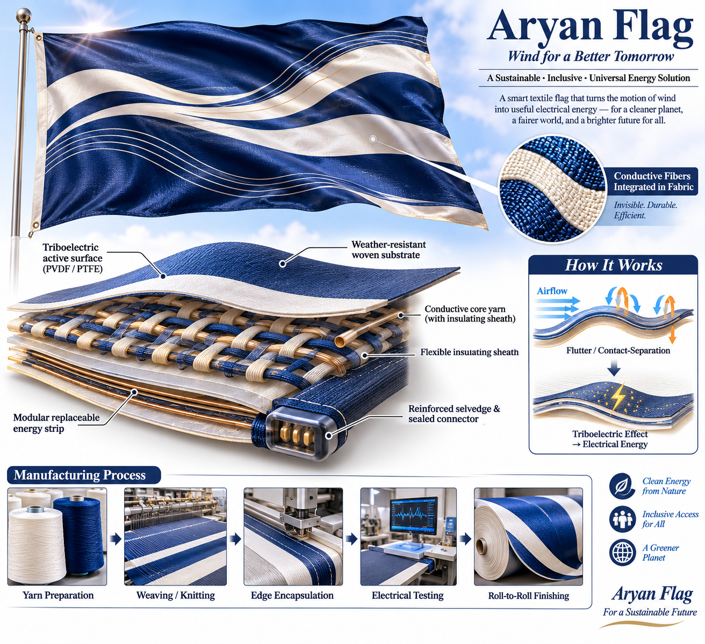
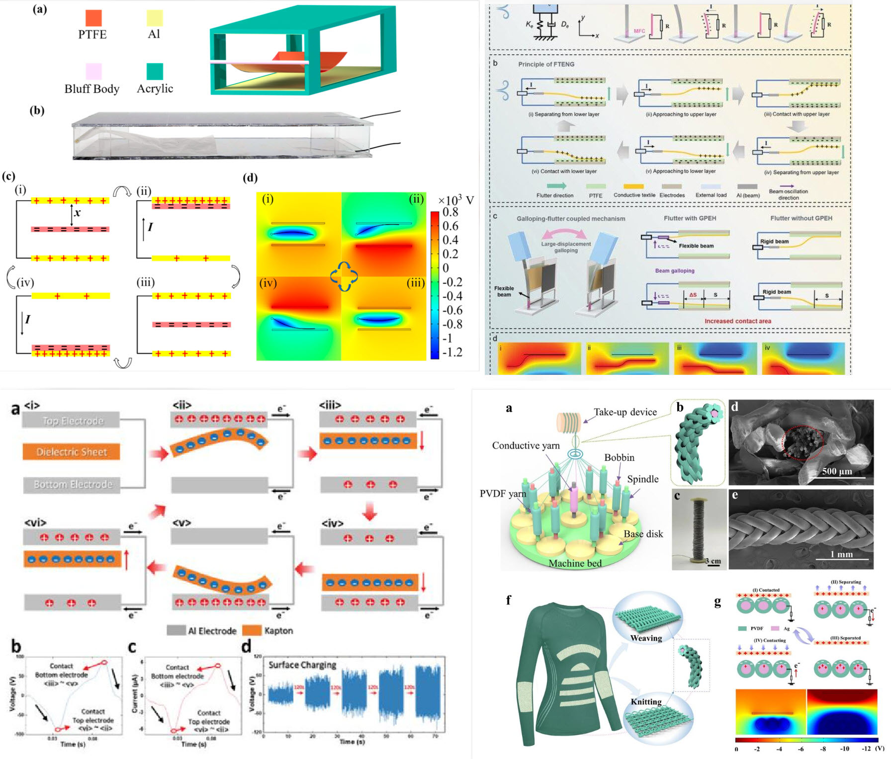
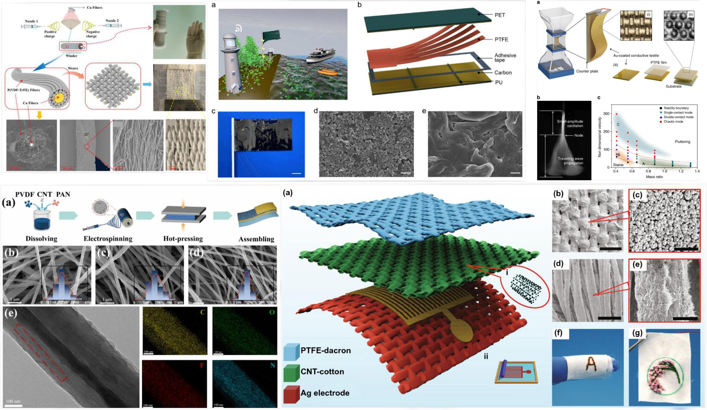
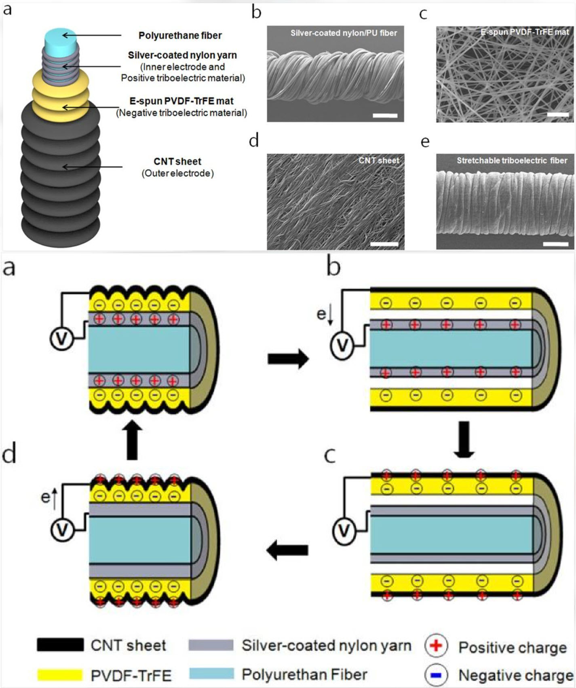
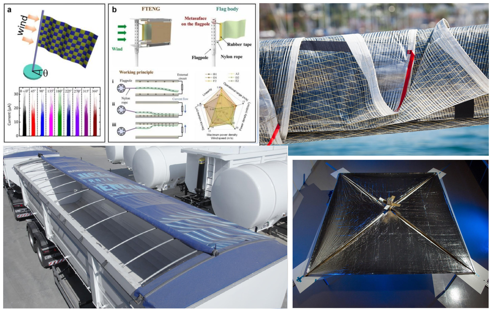

# Aryan Flag
### Wind for a Better Tomorrow — Smart Textile Concept
---

---

**Aryan Flag** is a proposed smart-textile concept that explores how the movement of wind and fabric can be converted into usable electrical energy. The project brings together textile engineering, conductive yarns, flexible functional materials, and energy-harvesting electronics.

The broader intention is to develop practical innovations that can be manufactured at accessible cost, adapted to different environments, and made available to people regardless of gender or inherited economic circumstances. The concept also explores applications that may contribute to resilient infrastructure and environmental recovery.

> **Development status:** Concept and research direction. The design shown is illustrative, not a validated product or a certified electrical generator. Performance, durability, safety, and manufacturing feasibility must be demonstrated through testing.

## 1. Design objectives

- Develop a flexible textile structure that can withstand repeated wind-driven motion.
- Integrate conductive yarns into the fabric rather than attaching bulky wires to its surface.
- Explore triboelectric energy harvesting from contact, friction, and separation between selected material surfaces.
- Make the energy-harvesting elements modular, repairable, and potentially replaceable.
- Design a manufacturing path compatible with established textile processes wherever possible.
- Keep the system inclusive and cost-conscious while respecting applicable intellectual-property rights and fair benefit-sharing.
---

---

## 2. Proposed textile architecture

The proposed fabric can be investigated as a hybrid textile with four functional layers:

1. **Structural textile:** A woven or knitted polyester or nylon substrate selected for strength, flexibility, UV resistance, and weather exposure.
2. **Triboelectric interface:** A selected pair of dissimilar materials. PVDF and PTFE are candidate materials for investigation; the final pairing must be selected by testing.
3. **Conductive yarn network:** Conductive yarns or filaments, such as stainless-steel microfilament yarn or carbon-based yarn, designed to collect charge or connect sensing/harvesting elements. Electrical insulation and corrosion protection may be required.
4. **Protective and connection features:** Flexible encapsulation, reinforced selvedges, strain relief, sealed connectors, and replaceable modules.

A possible yarn concept is a conductive core with a flexible insulating sheath. This is a design direction, not a fixed specification: the sheath, yarn diameter, weave density, and electrical layout must be selected according to the intended operating mode.

## 3. How wind-driven energy harvesting may work

Wind causes the fabric to flutter, bend, or vibrate. In a triboelectric nanogenerator (TENG) configuration, two dissimilar material surfaces repeatedly contact and separate. This can create surface charge and an electrical potential difference. Properly designed electrodes and power-management electronics can collect and condition the resulting electrical output.

The energy path is:

**Wind → fabric motion → contact/separation → electrical output → power conditioning → storage or load**

Important distinction: a high open-circuit voltage does not automatically mean high usable power. TENG devices can produce high voltage with low current. Evaluation must therefore include voltage, current, power under a defined load, energy per cycle, conversion efficiency, and long-term stability.

The system should not be described as producing a guaranteed amount of electricity until measurements from a reproducible prototype are available.
---

---

## 4. Candidate materials for investigation

| Function | Candidate materials | Selection considerations |
|---|---|---|
| Textile substrate | Polyester, nylon | Tensile strength, abrasion, UV and weather resistance |
| Conductive yarn | Stainless-steel microfilament, carbon-based yarn/CNT yarn | Conductivity, flexibility, fatigue, corrosion, cost |
| Triboelectric surface | PVDF, PTFE, other tested polymer pairs | Charge generation, wear, environmental durability |
| Flexible protection | TPU or compatible polymer coating | Flexibility, adhesion, moisture protection, repairability |
| Electrical interface | Flexible electrodes, sealed connectors | Strain relief, water ingress, safe handling |

These are candidate materials, not a final bill of materials. Compatibility, environmental impact, recyclability, worker safety, and supply-chain availability should be considered before selection.

## 5. Industrial development pathway

1. **Material screening:** Compare candidate material pairs and conductive yarns using controlled laboratory tests.
2. **Single-yarn / small-coupon prototype:** Verify electrical behavior and mechanical integrity before scaling.
3. **Textile integration:** Weave or knit a small fabric sample with repeatable geometry and documented process settings.
4. **Environmental and fatigue testing:** Test abrasion, flex cycles, tearing, humidity, water exposure, UV aging, temperature, and corrosion as appropriate.
5. **Electrical characterization:** Measure open-circuit voltage, short-circuit current, load curves, power, energy per cycle, and storage performance using documented test conditions.
6. **Pilot manufacturing:** Assess process repeatability, repairability, cost, quality control, and end-of-life handling.
7. **Field demonstration:** Test only after electrical and mechanical safety reviews, with suitable protection and monitoring.
---

---
## 6. Potential application areas

- **Flags and outdoor textile structures:** Small-scale demonstration of wind-driven fabric motion.
- **Vehicle covers and tarpaulins:** Explore energy harvesting from vibration and airflow, subject to durability and safety tests.
- **Sails and marine textiles:** Investigate motion and strain harvesting while accounting for salt, moisture, and UV exposure.
- **Lightweight aerospace structures:** A long-term research direction only. Space applications require separate qualification for vacuum, radiation, thermal cycling, outgassing, deployment, and mission safety.

These are potential research directions, not claims of readiness for commercial, marine, vehicle, or space deployment.

## 7. Validation plan

| Stage | Main question | Evidence required |
|---|---|---|
| V1 — Material | Does the selected material pair generate repeatable charge? | Controlled measurements and material records |
| V2 — Textile | Does the woven/knitted sample retain function under motion? | Repeated-cycle and abrasion results |
| V3 — Environment | Does performance persist under realistic exposure? | Humidity, water, UV, temperature and corrosion data |
| V4 — Manufacturing | Can samples be produced consistently? | Process parameters, yield and quality records |
| V5 — System | Is there useful net energy after conditioning? | Load tests, energy balance, storage and safety results |

A meaningful comparison should state the sample area, wind speed or motion profile, frequency, load, measurement equipment, test duration, and environmental conditions.

## 8. Safety and responsible development

- Treat generated electrical output as an experimental electrical system until characterized.
- Include suitable insulation, current limiting, grounding where appropriate, moisture protection, and safe connectors.
- Do not connect an unvalidated textile generator directly to mains electricity or critical equipment.
- Review fire behavior, material shedding, chemical exposure, and disposal/recycling.
- Avoid performance claims without reproducible measurements and independent review.

---

---

## 9. Innovation, access, and public benefit

The project is motivated by the idea that access to innovation should not depend solely on inherited capital. A practical development model can reduce entry barriers through low-cost prototypes, shared test methods, modular manufacturing, transparent documentation, and fair recognition of contributors.

Open publication does not automatically resolve every intellectual-property question. Before release, contributors should clarify ownership, licenses, third-party rights, patent status, and the legal effect of any public-domain or open-license statement in relevant jurisdictions. This README describes the technical concept; it is not legal advice.

## 10. Historical note: static electricity and Tesla

Frictional electricity has a long history, including electrostatic machines that used rubbing materials to generate charge. The triboelectric effect is therefore a real physical phenomenon.

However, a specific claim that Nikola Tesla demonstrated a high-voltage generator made by rubbing two canvas sheets should not be presented as established history without a reliable primary source. Tesla's documented high-voltage work should not be conflated with a textile triboelectric generator. This project should be evaluated on reproducible modern experiments rather than an unverified historical attribution.

## 11. Collaboration

Contributions that may help include:

- textile and polymer material research;
- conductive-yarn and electrode development;
- mechanical and environmental testing;
- power electronics and energy-storage design;
- low-cost manufacturing methods;
- lifecycle assessment, repair, and recycling;
- independent review of test data and safety.

When contributing, document methods, materials, dimensions, equipment, raw measurements, and limitations so that others can reproduce the work.

---

**Aryan Flag — a research and manufacturing concept for exploring energy from moving textiles.**

*Start with one yarn. Validate one fabric sample. Scale only when the evidence supports it.*
